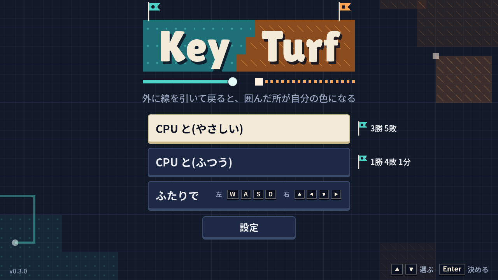
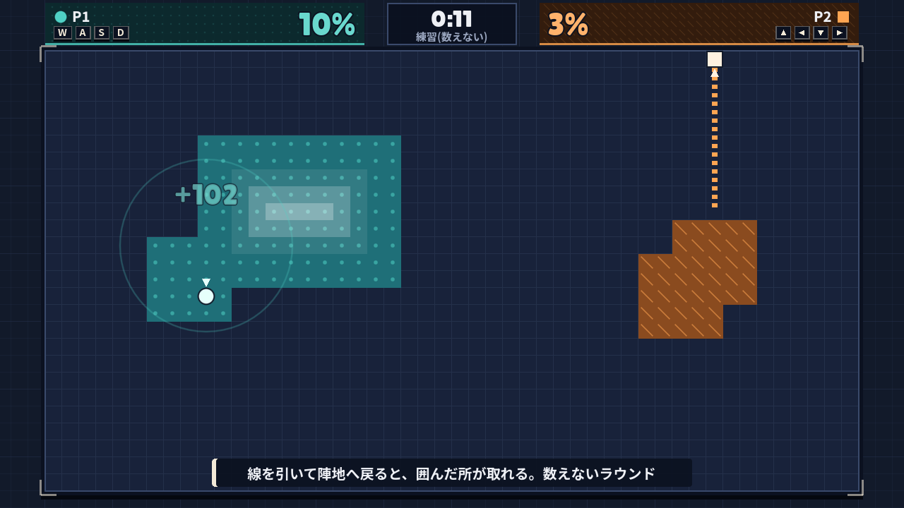
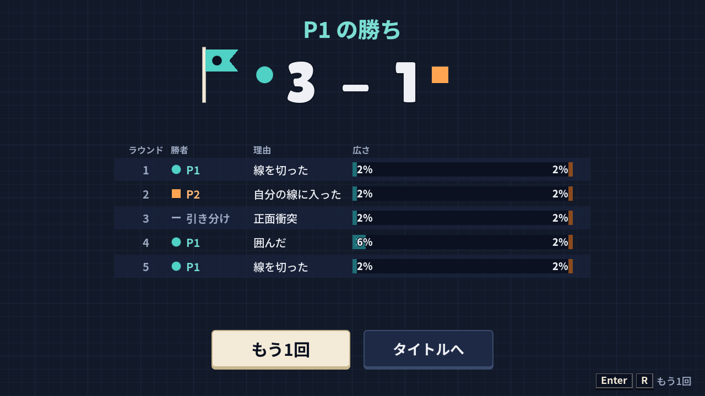

# KeyTurf

1 つのキーボードを 2 人で分ける陣取りです。左の人は **W A S D**、右の人は **矢印**。自分の陣地の外に線を引いて陣地へ戻ると、**囲んだ所が全部自分の色**になります。引きかけの線を相手に踏まれたら負け。30 秒で広い方がラウンドを取り、3 本先取です。1 人の時は CPU が相手になります。ブラウザで開くだけで遊べます。

**▶ 遊ぶ: https://takosasi-dev.github.io/key-turf/** (デスクトップの Chrome・Edge・Firefox。キーボードで遊びます。インストール不要)

> v0.3.0。人に遊んでもらう確かめはまだです。進む速さや CPU の強さなどの調整値は、仕様の初期値のままです。ブラウザは、窓なしの Chrome で起動と一通りの流れ(タイトル → 練習 → 試合 → 結果 → もう1回、設定、一時停止)を確かめました。本物のキーボード・Edge・Firefox・音を耳で聞くことは、まだです。

| タイトル | ふたりで(練習の中盤) | 結果 |
|---|---|---|
|  |  |  |

見た目は「夜の卓の陣取り盤」です。藍の卓に盤を置き、2 陣は色に加えて頭の形(丸・四角)と陣地の模様(点・斜線)で分け、選んだボタンは象牙の駒の色で示します。題字・数字は Lilita One、日本語は Noto Sans JP です。

## 遊び方

- 頭は止まらずに 1 マスずつ進みます。キーを押すと、次に進む時にその向きへ曲がります(続けて 2 回まで先に押しておけます)。今の向きの逆へは曲がれません。
- 自分の陣地の外を通ったマスは**線**になります。陣地へ戻ると、線と、線と陣地で囲んだ所が自分の陣地になります。相手の陣地も囲めば取れます。
- 負けになるのは次の時です。
  - 引きかけの線を相手に踏まれた(陣地の外にいる頭のマスも線に入ります)
  - 自分の線に入った
  - 囲まれた所に自分の頭か線があった
  - 陣地が 0 マスになった
- 2 人の頭が同じマスに入った時・すれ違った時、2 人が同時に負けた時は引き分けです。盤の端では止まるだけで、負けません。
- 30 秒たつと、陣地の広い方がそのラウンドの勝ち。3 ラウンド先に取った方が試合の勝ちです(数えるラウンドは最大 9)。
- その起動で最初の試合の前に、15 秒の練習のラウンドがあります(数えません)。
- Esc で一時停止。

| 見分け方 | P1(左の人・あなた) | P2(右の人・CPU) |
|---|---|---|
| 陣地 | 青緑、マスの中央に点 | 茶色、マスに斜線 |
| 線 | 実線 | 破線 |
| 頭 | 丸 | 四角 |

キーは**位置**で取るので、JIS 配列でも US 配列でも、同じ位置のキーが同じ向きになります。CPU との試合では、W A S D と矢印のどちらでも自分(P1)を動かせます。

## 入口

- **CPU と(やさしい)**: 攻めてこない CPU。決まりを覚える相手です。
- **CPU と(ふつう)**: 線を引いたあなたを切りに来る CPU。
- **ふたりで**: 隣の人と 1 台で。左 W A S D・右 矢印。

CPU との通算の勝ち負けは、ブラウザの中に段ごとに残ります。

## しくみ

- **ゲームの決まりは `core/` にだけ**あります(移動・線・囲み・負け・ラウンド・試合・CPU)。画面は `sim.snapshot()` と `sim.events()` を読んで描くだけです。
- 1/120 秒刻みで進め、入力は人(0・1)と向き(0〜3)の整数だけを受けます。2 人は同じ刻みで同時に動き、勝ち負けは 2 人ぶんを同じ盤で求めてからまとめて決めます。入力を左右入れ替え・180 度回すと結果も入れ替わることを、テストで確かめています。
- 囲んだ所は、盤の外側から「自分の陣地と線でないマス」を幅優先でたどり、たどり着けなかったマスとして求めます(`core/grid.gd` の 1 か所)。
- 保存はブラウザの中(localStorage の `key-turf/save`)だけです。サーバーとの通信やアクセス解析はありません。

## 動作環境

- Godot 4.7.2-stable(GDScript、レンダラー Compatibility)
- Web 書き出しはスレッド無し・拡張無し

## 開発

```
# テスト(全件成功で終了コード 0。CPU 同士の 100 ラウンドと 20 試合を含むので 2 分ほど)
godot --headless --import
godot --headless --script res://tests/run_tests.gd

# Web 書き出し(書き出しテンプレート 4.7.2 が要る)
godot --headless --export-release "Web" build/web/index.html

# 窓なしで本体を動かし、S0 → CPU と(ふつう)→ 結果まで通す(P1 にも CPU を付ける。Python)
python tools/gd.py smoke 40000 --auto=normal

# 描画の道(大きな囲み・決着の演出 8 種・キーの確かめ)を窓なしで 1 回ずつ通す
python tools/gd.py run res://tools/draw_check.gd

# ブラウザで確かめて画面を撮る(Node.js と Chrome。窓なし・消音・使い捨てのプロフィール。build/web を配る)
node tests/web/check.mjs          # 流れ・決まった道で 5 種の決着・一時停止・保存・通信 0 件・キーの確かめ
node tests/web/check.mjs --cpu    # CPU と(やさしい)を JS の bot で 1 試合
node tests/web/shots.mjs after    # 全部の画面を 5 つの大きさで撮る(--docs で README の 3 枚を docs/ へ)
node tests/web/boottime.mjs       # 起動(S0 まで)の秒数
node tests/web/framecost.mjs      # 画面ごとの 1 フレームの重さ(KT_WEB=前の書き出し で前の版と比べる)
KT_URL=https://takosasi-dev.github.io/key-turf/ node tests/web/boot.mjs   # 公開した物の起動とコンソール

# CPU 2 段の強さの数字(bot との試合・ふつう 対 やさしい・1 回の移動の計算時間)
python tools/gd.py run res://tools/bot_report.gd 20

# 字体を画面の文字に絞る・効果音を作る(Python)
pip install fonttools
python tools/subset_font.py
python tools/gen_sfx.py
```

`tools/gd.py` は環境変数 `GODOT` の Godot を `--headless` で呼びます。`main` に push すると、GitHub Actions がテスト → Web 書き出し → GitHub Pages への配置を行います(`.github/workflows/pages.yml`)。

公開 URL に `?keys=1` を付けて開くと、押したキーの中身(`physical_keycode` など)を文字で出す確かめの画面になります(Esc 2 回でタイトルへ)。設定の「キーの確かめ」では、2 人で同時に押したキーが両方光るかを見られます。

## 開発状況

- v0.3.0。仕様の画面・決まり・CPU 2 段・保存・設定・一時停止・キーの確かめは全部入っています。テスト 75 件が通ります。
- v0.3.0 の UI の作り直し: 自分の Theme(ボタン・スライダー・入力欄)、陣地の題字、S0 とタイトルで 2 陣が盤の外で陣を取り合う背景、マスが縮むワイプの切り替わり、キーの絵(矢印を字でなく形で描く)、HUD の 2 陣の板、結果の旗・数え上げ・行の帯、UI の音(選ぶ・決める)。決まり・調整値・CPU・保存の形は変えていません。窓なし Chrome の 1 フレームの重さは v0.2.0 と同じ幅です(本物の GPU での重さは未確認)。
- v0.2.0 の磨き: 決着の帯を決め手の反対側(上か下)へ動かして見せ場を隠さないようにし、勝った人の色を付けました。囲んだ所は光の波で塗られ、「+n」は人の色で跳ね、広く囲むほど音が高くなります。相手の線を切った点には × 印が出て、切られた線は切った点から割れて飛びます。試合の決着は 1.5 秒見せてから結果へ移ります。縦横比が 16:9 でない窓では、余りを黒でなく背景の色にしました。
- ブラウザ(窓なしの Chrome。`tests/web/`): 起動・S0 → タイトル → 設定とキーの確かめ → ふたりで(練習と 5 ラウンド)→ 結果 → もう1回 → 一時停止(Esc・タブが裏)、CPU と(やさしい)の 1 試合、保存(`key-turf/save`。ほかのゲームの保存を消さない)、読み込みの後の通信 0 件、矢印でページが動かないこと、コンソールのエラー 0 件を確かめました。キーは CDP で本物のキーのイベントとして送っています。
- CPU の強さ(ヘッドレスで bot と 20 試合ずつ。CPU から見た勝ち-負け-引き分け): やさしい は ランダム bot に 20-0-0・何もしない bot に 20-0-0・回る bot に 20-0-0。ふつう は ランダム bot に 20-0-0・回る bot に 20-0-0・何もしない bot に 20-0-0。ふつう 対 やさしい は ふつう の 20 勝 0 敗。CPU 同士の 100 ラウンドで、CPU が自分の線に入った回数は 0。
- v0.1.1 の直し: v0.1.0 の ふつう は、真っすぐ進むだけの相手の線を切りに行って正面からぶつかり、何もしない bot に 1-10-9 で負け越していました。攻めの的と道から、相手の頭のマスと、頭が次に入りうるマス(前と左右)を外して、20-0-0 になりました。
- まだ確かめていないこと: 人が遊んだ手触りと調整値、本物のキーボード(JIS・US)で 2 人が同時に押した時の届き方、日本語入力がオンの時、Edge・Firefox、本物の画面でのフレームの時間、音を耳で聞くこと。
- 撤退基準: R-1(CPU やさしい と続けて「もう1回」を押すか)・R-2(W A S D と矢印の同時押しが届くか)・R-3(2 人組が 2 試合目を自分から始めるか)・R-4(ふつう に人が 10 試合で 2〜8 試合勝てるか)は、どれも人と本物のキーボードが要るので未判定です。

## ライセンス

MIT(`LICENSE`)。

同梱の字体 2 つは、どちらも SIL Open Font License 1.1 です(出どころとハッシュは `THIRD-PARTY-NOTICES.md`)。

- Noto Sans JP(画面の日本語): 画面に出す字だけに絞った物。原文 `assets/fonts/OFL_NotoSansJP.txt`
- Lilita One(題字と数字。v0.3.0 から): Copyright (c) 2011 Juan Montoreano, with Reserved Font Name Lilita。Reserved Font Name があるので、原本のまま手を加えずに同梱しています。原文 `assets/fonts/OFL_LilitaOne.txt`
